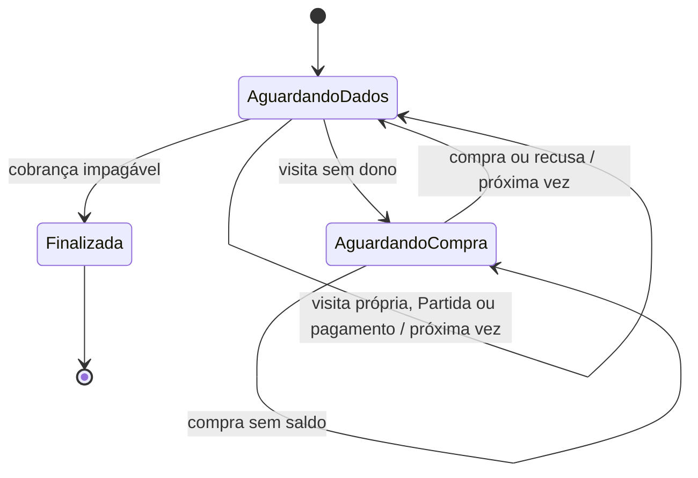

# Arquitetura e padrões GoF

## Limites da base

A aplicação é um processo local, com dados em memória e dois jogadores no
mesmo terminal. O tabuleiro de oito casas permite demonstrar o fluxo comum de
turnos, compras e cobranças. Somente a Partida foi criada como lugar especial;
outros efeitos e as regras associadas permanecem pendentes.

## Responsabilidades e dependências

| Componente | Responsabilidade | Não é responsável por |
| --- | --- | --- |
| `presentation/cli/Terminal` | Ler texto, criar comandos e apresentar situação/histórico. | Calcular taxas, decidir vencedor ou movimentar saldos. |
| `application/controllers/ControladorPartida` | Invocar um `Comando` sobre o jogo recebido. | Interpretar texto ou duplicar validações do estado. |
| `application/commands` | Representar solicitações e seus argumentos. | Determinar se uma ação é válida nesta etapa. |
| `application/HistoricoTextual` | Observar eventos e acumular linhas em memória. | Fazer `print`, ler entrada ou mudar regras. |
| `domain/Jogo` | Coordenar turno, movimento, compra, cobrança, vitória e publicação de fatos. | Interpretar comandos textuais ou conhecer o terminal. |
| `domain/Jogador` | Proteger saldo, posição e condição de eliminação. | Guardar uma cópia das propriedades do tabuleiro. |
| `domain/Tabuleiro` | Organizar percurso, calcular destino/passagens e consultar aquisições. | Ler dados ou aplicar efeitos especiais indefinidos. |
| `domain/Logradouro` e subclasses | Resolver visitas por polimorfismo; propriedades controlam aquisição. | Conhecer comandos ou apresentação. |
| `domain/Configuracao` | Reunir e validar parâmetros numéricos da demonstração. | Ser arquivo de persistência ou menu de configuração. |
| `main.py` | Montar tabuleiro, estratégias, jogadores, publicador, observador, controlador e terminal. | Conter regras de cobrança ou de estados. |

Apresentação depende da aplicação e consulta entidades do domínio. Aplicação
depende do domínio. Domínio depende apenas da biblioteca padrão e de seus
próprios módulos; não importa aplicação ou apresentação. Anotações de tipo
usam `TYPE_CHECKING` entre logradouros/estados e `Jogo`, evitando ciclos de
importação em execução.

Não há repositórios de persistência, camada de serviços genérica nem entidade
de banco. A propriedade de cada aquisição é a fonte única do portfólio;
`Tabuleiro.adquiridos_por` monta a consulta sem sincronizar listas duplicadas.

## Strategy — taxas de empresas

**Problema:** empresas podem calcular cobranças de formas distintas.

- Contexto: `Empresa` em [`domain/logradouros.py`](../src/jogo_pds/domain/logradouros.py).
- Contrato: `EstrategiaTaxa.calcular(dados)`.
- Estratégias concretas: `TaxaFixa` e `TaxaVariavel`, em
  [`domain/taxas/estrategias.py`](../src/jogo_pds/domain/taxas/estrategias.py).
- Composição: `main.criar_jogo_demo` injeta cada estratégia na empresa.

Trechos existentes:

```python
# Empresa.calcular_cobranca
valor = self._estrategia.calcular(dados)
validar_inteiro(valor, "Taxa calculada")
return valor

# TaxaVariavel.calcular
return self.multiplicador * dados.soma
```

`Empresa` não seleciona algoritmos com condicionais sobre o tipo de taxa.
Uma nova forma de cálculo implementa o contrato e é injetada na composição.
A fórmula variável é uma interpretação provisória (INT-02), não uma fórmula
explicitamente fornecida pelo enunciado. Imóveis usam aluguel simples e não
precisam de uma estratégia adicional nesta etapa.

## State — etapas e ações permitidas

**Problema:** não se pode informar novos dados durante uma decisão de compra,
comprar sem oferta ou continuar uma partida encerrada.

- Contexto: `Jogo`, em [`domain/jogo.py`](../src/jogo_pds/domain/jogo.py).
- Contrato: `EstadoPartida`, em
  [`domain/estados/partida.py`](../src/jogo_pds/domain/estados/partida.py).
- Estados concretos: `AguardandoDados`, `AguardandoCompra` e `Finalizada`.

O contrato implementa rejeições explícitas com `AcaoInvalida`. Cada estado
sobrescreve somente as ações que permite; não há métodos vazios simulando
sucesso. `Finalizada` herda as três rejeições porque não permite novas ações.

```python
# Jogo.informar_dados
self.estado.informar_dados(self, dados)

# AguardandoDados.informar_dados
jogo.mover_e_resolver(dados)

# AguardandoCompra.comprar
jogo.adquirir(self.propriedade)
```



Movimento e resolução de cobrança são síncronos, portanto não exigem estados
adicionais de espera. `Jogo` modifica o estado ao coordenar essas transições.
As operações `mover_e_resolver`, `oferecer_compra`, `adquirir`, `cobrar` e
`concluir_turno` são colaborações internas do domínio. A aplicação deve entrar
pelas ações `informar_dados`, `comprar` e `recusar_compra`, que delegam ao estado.
Sair do terminal encerra a sessão, sem declarar vitória ou produzir uma
finalização fictícia do jogo.

## Command — ações do jogador

**Problema:** separar a leitura textual de uma solicitação da sua execução.

- Contrato: `Comando.executar(jogo)`.
- Comandos concretos: `InformarDados`, `Comprar` e `RecusarCompra`, em
  [`application/commands/acoes.py`](../src/jogo_pds/application/commands/acoes.py).
- Invocador: `ControladorPartida`, em
  [`application/controllers/partida.py`](../src/jogo_pds/application/controllers/partida.py).
- Receptor: `Jogo`.
- Cliente que cria os comandos: `interpretar_comando`, na apresentação.

```python
# ControladorPartida.executar
comando.executar(self.jogo)

# InformarDados.executar
jogo.informar_dados(self.dados)
```

O controlador recebe qualquer implementação de `Comando`. Os comandos não
reproduzem as regras do domínio; mesmo um comando criado fora do terminal
passa pelo estado atual. Não há desfazer, fila, replay ou persistência de
comandos, pois essas responsabilidades não foram solicitadas.

## Observer — histórico desacoplado

**Problema:** registrar acontecimentos sem fazer as regras chamarem o terminal.

- Sujeito/publicador explícito: `Publicador`, que mantém inscrições e notifica.
- Contrato de observador explícito: `Observador.atualizar(evento)`.
- Informação publicada: `Evento`, imutável, com tipo e descrição.
- Observador concreto: `HistoricoTextual`, na aplicação.
- Produtor dos fatos: `Jogo`, que recebe o publicador por injeção.

Contratos em
[`domain/eventos/observacao.py`](../src/jogo_pds/domain/eventos/observacao.py);
observador em [`application/historico.py`](../src/jogo_pds/application/historico.py).

```python
# Composição em main.criar_jogo_demo
publicador = Publicador()
historico = HistoricoTextual()
publicador.inscrever(historico)
jogo = Jogo(jogadores, tabuleiro, publicador, config.bonus_partida)

# Publicador.publicar
for observador in tuple(self._observadores):
    observador.atualizar(evento)

# HistoricoTextual.atualizar
self._linhas.append(f"[{evento.tipo}] {evento.descricao}")
```

O terminal consulta as linhas do histórico e imprime as novas; o domínio não
conhece `HistoricoTextual`, `Terminal`, `input` ou `print`. Podem existir vários
observadores; inscrições repetidas não duplicam notificações. A remoção de um
observador interrompe notificações futuras. As notificações são síncronas e
somente em memória; não há barramento de mensagens ou event sourcing.

Os observadores desta etapa devem ser consumidores simples, sem alterar o
jogo. Erros inesperados de observadores propagam; não há isolamento de falhas,
reexecução ou transação de eventos. Essas capacidades não são necessárias ao
histórico local atual.

## Polimorfismo e contratos

Além dos quatro padrões, `Logradouro.receber_visita` permite que `Jogo` resolva
a casa de destino sem selecionar categorias. `Propriedade` compartilha compra
e propriedade, enquanto `Imovel` e `Empresa` especializam a cobrança.
`LugarEspecial` permanece abstrato; `PontoPartida` é seu único concreto.
Não se instanciam contratos de efeitos ainda não implementados.

Os testes exercitam os contratos através das implementações reais: dados
inválidos, estratégias, transições, compras, cobranças, limites de saldo,
passagem, notificações e integração de comandos com a CLI.
