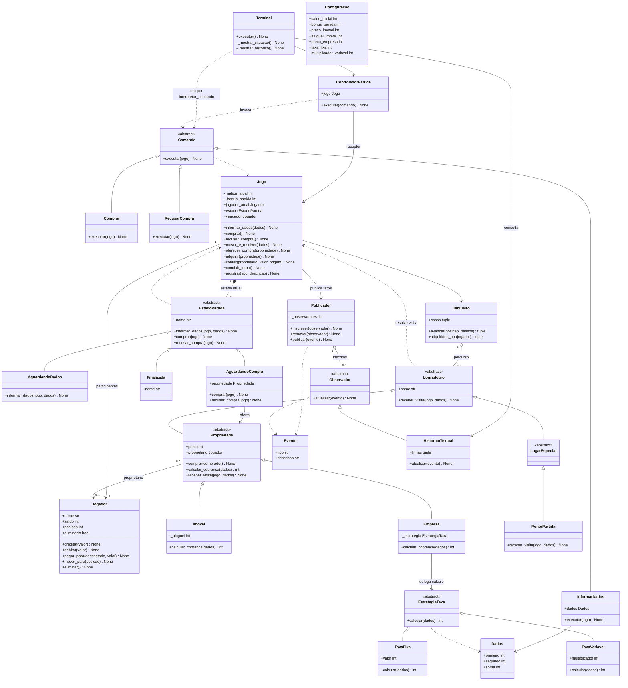

# Diagrama de classes inicial

Representa as classes centrais existentes nesta etapa. Métodos auxiliares,
exceções e funções livres foram omitidos para legibilidade. O diagrama deve
evoluir junto do código; não antecipa classes de efeitos especiais ausentes.

## Correspondência dos padrões

| Padrão | Participantes |
| --- | --- |
| Strategy | `Empresa`, `EstrategiaTaxa`, `TaxaFixa`, `TaxaVariavel`. |
| State | `Jogo`, `EstadoPartida`, `AguardandoDados`, `AguardandoCompra`, `Finalizada`. |
| Command | `Comando`, `InformarDados`, `Comprar`, `RecusarCompra`, `ControladorPartida`, `Jogo`; criação na CLI. |
| Observer | `Jogo`, `Publicador`, `Observador`, `Evento`, `HistoricoTextual`. |

As propriedades de leitura aparecem como atributos públicos para simplificar
a notação; não representam setters disponíveis. `vencedor` e `proprietario`
podem ser `None`. A enumeração das casas é imutável (`tuple`); as entidades
guardadas nela continuam mutáveis. `Configuracao` e `Dados` são dataclasses
imutáveis. A função livre `main.criar_jogo_demo` usa `Configuracao` e monta os
objetos, por isso não existe uma classe de composição no diagrama.
